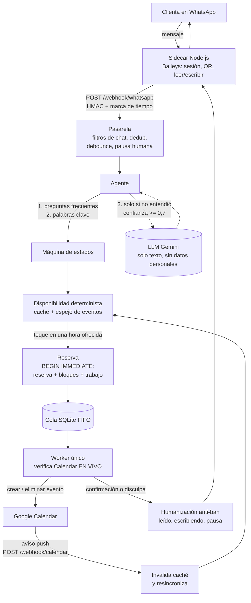

# AgenteManiculista

Agente de WhatsApp que agenda las citas de una manicurista independiente en Colombia.
Atiende a las clientas por WhatsApp (el número de la dueña, con la app WhatsApp Business), consulta
y escribe en su Google Calendar y nunca agenda dos citas en el mismo horario.

> **Principio del producto:** el modelo de lenguaje (LLM) *interpreta*, nunca *ejecuta*. La
> disponibilidad, la escritura en Calendar y la confirmación de una cita las decide código
> determinista. Con `PROVEEDOR_LLM=none` el sistema funciona completo (botones y palabras clave).

Este archivo tiene dos partes: **[Parte técnica](#parte-técnica)** (para quien instala y opera) y
**[PARA LA CLIENTA](#para-la-clienta)** (para la dueña del negocio, sin tecnicismos; el paso a paso
completo está en [docs/manual-clienta.md](docs/manual-clienta.md)).

---

## Parte técnica

### Qué hace y cómo está armado



| Pieza | Dónde | Responsabilidad |
|---|---|---|
| API y ciclo de vida | `app/main.py`, `app/produccion.py` | Arma el grafo de dependencias y las tareas de fondo |
| Dominio | `app/disponibilidad.py`, `app/reservas.py`, `app/conversacion.py` | Reglas puras: bloques, márgenes, estados, anti doble reserva |
| Cola y worker | `app/cola.py`, `app/worker.py` | Un solo worker por calendario, FIFO, reintentos con backoff, verificación en vivo |
| Calendar | `app/calendario.py`, `app/cache.py`, `app/canal.py` | Adaptador Google, espejo con `syncToken`, canal push y modo degradado |
| Intención | `app/intencion.py`, `app/llm/` | Prompt sin datos personales, validación estricta, cuotas y cortacircuitos |
| WhatsApp | `sidecar/`, `app/webhook.py`, `app/whatsapp.py` | Transporte Baileys y política anti-ban (en Python) |
| Datos | `app/modelos.py` | SQLite en modo WAL (un solo proceso) |
| Demo | `app/simulador/` | Interfaz `/demo` con calendario simulado, sin credenciales |

Documentos de diseño: [SDD.md](SDD.md) (fuente de verdad, v0.4), [design.md](design.md),
[requirements.md](requirements.md), [TDD.md](TDD.md), [docs/adr/](docs/adr/) y
[docs/threat-model.md](docs/threat-model.md). Operación: [docs/runbook.md](docs/runbook.md).

### Requisitos

- Python 3.12 y [uv](https://docs.astral.sh/uv/) (desarrollo); Docker y Docker Compose (despliegue).
- Node.js 22 solo para correr las pruebas del sidecar fuera de Docker.
- Una cuenta de servicio de Google con acceso al calendario (ver más abajo).

### Instalación y pruebas

```bash
make install        # crea el venv y sincroniza dependencias desde uv.lock
make test           # pruebas con cobertura de ramas (umbral 85 %)
make lint           # ruff, formato y mypy --strict
make sidecar-test   # pruebas del sidecar de WhatsApp (Node.js 22)
make ci             # lint + pruebas + auditoría de dependencias
```

### Probar sin credenciales (demo)

```bash
cp .env.example .env     # y fija ENTORNO=demo, SIMULADOR=true, PROVEEDOR_LLM=none
make run                 # abre http://localhost:8000/demo
```

El simulador usa un calendario en memoria, muestra la conversación y permite ver la "carrera" entre
dos clientas por el mismo horario: una se confirma y la otra recibe una disculpa. No necesita
Google, WhatsApp ni Gemini.

### Despliegue con Docker

```bash
docker compose build
docker compose up -d                       # backend (un solo proceso: --workers 1)
docker compose --profile whatsapp up -d    # además, el sidecar de WhatsApp
```

- **Una sola instancia y un solo proceso:** el worker único y SQLite lo exigen. El arranque falla si
  `WEB_CONCURRENCY > 1`.
- Los datos viven en el volumen `/data` (`agenda.db` y `baileys_auth`). **Respáldalos** (ver runbook).
- El sidecar **no publica puertos**: solo el backend lo alcanza por la red interna de Compose.
- Detrás de un proxy inverso con HTTPS, expón únicamente `/webhook/calendar` (hacia Google) y, si lo
  necesitas, `/demo` y `/health`. **No expongas `/webhook/whatsapp` ni `/admin`** a Internet.
- En producción (`ENTORNO=produccion`) el arranque falla de inmediato si falta alguna de:
  `GOOGLE_SERVICE_ACCOUNT_JSON`, `SIDECAR_URL`, `SIDECAR_TOKEN`, `WEBHOOK_SECRET`.
- La demo pública en Render (`render.yaml`, plan gratuito, sin disco) **no se despliega sola**:
  requiere una orden explícita.

### Google Calendar

1. En Google Cloud, crea un proyecto, habilita **Google Calendar API** y crea una **cuenta de
   servicio**; descarga su clave JSON (no la subas al repositorio).
2. En Google Calendar de la dueña, comparte el calendario con el correo de la cuenta de servicio con
   el permiso **"Hacer cambios en los eventos"**.
3. Pon el JSON (o la ruta a un archivo montado fuera del repo) en `GOOGLE_SERVICE_ACCOUNT_JSON` y el
   correo o id del calendario en `config/negocio.yaml` → `calendario_id`.
4. Alcance solicitado: `https://www.googleapis.com/auth/calendar.events` (el mínimo necesario).

**Aviso de cambios (push).** Si `CALENDAR_WEBHOOK_URL` es una URL HTTPS pública válida, el sistema
registra un canal `events.watch`, lo renueva antes de que expire y, cuando la dueña agenda a mano,
invalida el caché al instante. Si no hay URL pública o Google rechaza el canal, entra en **modo
degradado**: refresca el calendario cada 5 minutos (`refresco_degradado_minutos`), lo registra en el
log (`modo_degradado`) y lo muestra en `/health`. Nunca se agenda con datos del caché: el worker
verifica Calendar en vivo antes de escribir.

### Variables de entorno

Todas están en [.env.example](.env.example). Nunca subas `.env` al repositorio.

| Variable | Obligatoria | Descripción |
|---|---|---|
| `ENTORNO` | no | `desarrollo` (defecto), `demo` o `produccion` |
| `SIMULADOR` | no | `true` expone `/demo` con calendario simulado |
| `LOG_LEVEL` | no | `DEBUG`, `INFO`, `WARNING`, `ERROR` |
| `DATABASE_URL` | no | SQLite; en Docker `sqlite:////data/agenda.db` |
| `PROVEEDOR_LLM` | no | `gemini` o `none` (defecto: `none`) |
| `GEMINI_API_KEY` | si `gemini` | Clave de Google AI Studio |
| `GEMINI_MODEL` | no | Defecto `gemini-3.5-flash-lite` |
| `GEMINI_TIER` | no | `free` o `paid`; **en producción con Gemini debe ser `paid`** |
| `SIDECAR_URL` | producción | URL interna del sidecar (`http://sidecar:3000`) |
| `SIDECAR_TOKEN` | producción | Bearer hacia el sidecar; ≥ 32 caracteres al azar |
| `WEBHOOK_SECRET` | producción | Clave HMAC con la que el sidecar firma; ≥ 32 caracteres |
| `ADMIN_TOKEN` | no | Habilita `/admin/whatsapp/qr` (cabecera `X-Admin-Token`); ≥ 32 caracteres |
| `GOOGLE_SERVICE_ACCOUNT_JSON` | producción | JSON de la cuenta de servicio o ruta al archivo |
| `CALENDAR_WEBHOOK_URL` | no | URL HTTPS pública de `/webhook/calendar`; vacío = modo degradado |
| `CALENDAR_CHANNEL_TOKEN` | con push | Secreto que Google devuelve en cada aviso; ≥ 32 caracteres |
| `DEMO_RETARDO_CALENDARIO_S` | no | Solo demo: retardo del calendario simulado (0–5 s) |

Generar un secreto: `python -c "import secrets; print(secrets.token_urlsafe(48))"`.
Los textos que ve la clienta viven en `config/mensajes.yaml`; precios, horarios, domicilio y
políticas en `config/negocio.yaml` y `config/servicios.yaml`.

### Operación de la cola y de la conexión

- **Cola:** estados `PENDIENTE → CONFIRMADA | EXPIRADA | FALLIDA` y `CANCELANDO → CANCELADA`. Un
  trabajo falla solo tras 5 intentos con backoff exponencial (tope 64 s). Con cuota agotada de
  Calendar (403/429 de `usageLimits`) la cola se pausa y se reanuda sola.
- **`/health`:** profundidad de la cola, trabajos fallidos, tasa de acierto del caché, porcentaje de
  mensajes resueltos sin LLM, `modo_degradado`, `canal_expira_en`, `cola_pausada_hasta` y el estado
  de WhatsApp (`whatsapp_estado`: `open`, `close`, `loggedOut`…).
- Procedimientos completos (restauración de SQLite, canal expirado, sesión de WhatsApp cerrada,
  rotación de secretos): [docs/runbook.md](docs/runbook.md).

### Privacidad y `GEMINI_TIER`

- Al LLM **solo** llega el texto de la clienta ya depurado (teléfonos, correos y direcciones
  enmascarados), el catálogo, la fecha de hoy y el nombre del estado. Nunca teléfono, nombre,
  dirección, historial ni identificadores.
- Según la [página de precios de Gemini API](https://ai.google.dev/gemini-api/docs/pricing)
  (consultada el 2026-10-30), el contenido del **tier gratuito se usa para mejorar los productos de
  Google** y el del **tier de pago no**. Por la Ley 1581 de 2012 (protección de datos), en
  producción con Gemini el sistema **exige `GEMINI_TIER=paid`** y se niega a arrancar si no.
- En los logs el teléfono siempre va enmascarado; nunca se registran tokens ni el contenido enviado
  al LLM.
- Retención: las conversaciones se anonimizan a los 365 días.

### Estimación de costo (300 conversaciones al mes)

Precio de `gemini-3.5-flash-lite`, tier de pago, según la página oficial citada: **US$ 0,30 por
millón de tokens de entrada y US$ 2,50 por millón de salida**. El LLM solo se consulta cuando las
preguntas frecuentes y las palabras clave no entienden el mensaje.

Supuestos de **peor caso** (estimados, no medidos): las 300 conversaciones tienen 4 mensajes y los 4
llegan al LLM (1.200 consultas), con ≈ 800 tokens de entrada y ≈ 60 de salida cada una.

| Concepto | Tokens | Costo (US$) |
|---|---|---|
| Entrada | 1.200 × 800 = 0,96 M | 0,29 |
| Salida | 1.200 × 60 = 0,072 M | 0,18 |
| **Total del LLM, peor caso** | | **≈ 0,47** |

En la práctica el costo es menor (la mayoría de los mensajes se resuelven con botones y palabras
clave). Además hay topes por clienta (10/hora) y globales (500/día). Con `PROVEEDOR_LLM=none` el
costo del LLM es cero. A esto se suma el alojamiento (VPS o servicio con disco persistente; **precio
no verificado**, depende del proveedor). Google Calendar API y WhatsApp vía Baileys no tienen cargo
por mensaje.

### Riesgo de WhatsApp vía Baileys (léelo antes de producción)

Baileys es una biblioteca **no oficial** que se conecta como "dispositivo vinculado". **Va contra
los términos de servicio de WhatsApp/Meta** para uso automatizado y la cuenta puede ser restringida
o bloqueada. El diseño lo reduce con controles anti-ban (solo responder a quien escribe primero,
simular lectura y escritura, un solo mensaje por respuesta, límites por clienta y globales, pausa
cuando la dueña interviene), pero **no lo elimina**. La alternativa oficial (WhatsApp Cloud API)
obliga a migrar el número fuera de la app WhatsApp Business y quedó como plan B (ADR-009). Nunca
hagas envíos masivos ni mensajes no solicitados.

### Extensión futura: recordatorios

Los recordatorios de cita **no están incluidos**: con Baileys implicarían escribirle a la clienta
sin que ella haya escrito antes, justo lo que más riesgo de bloqueo genera. Quedan como extensión
futura, a decidir junto con la dueña (por ejemplo, recordatorio dentro de las 24 horas posteriores
a su último mensaje, o paso a la API oficial).

### Seguridad

Firma HMAC con marca de tiempo en el webhook de WhatsApp, token de canal en el de Calendar,
secretos de ≥ 32 caracteres, contenedores sin root, límites de tasa, validación estricta de toda
salida del LLM y revisión de seguridad por bloque (ver `AI_PROCESS.md`). Modelo de amenazas en
[docs/threat-model.md](docs/threat-model.md).

---

## PARA LA CLIENTA

*(Resumen. El paso a paso con detalle está en [docs/manual-clienta.md](docs/manual-clienta.md).)*

**¿Qué hace el asistente?** Atiende por WhatsApp a las personas que le escriben a tu número: les
muestra los servicios y los horarios libres, y agenda la cita en tu Google Calendar. Si dos personas
piden la misma hora, confirma a una y a la otra le ofrece otra hora. **Tú siempre mandas:** si
respondes tú misma a una clienta, el asistente se calla con ella durante 2 horas.

**Lo que tienes que hacer una sola vez**
1. Conservar tu WhatsApp Business en tu celular y vincular el asistente escaneando un código QR
   (como WhatsApp Web).
2. Compartir tu Google Calendar con el correo que te indique quien instala el sistema, con permiso
   para "Hacer cambios en los eventos".

**Lo que puedes cambiar tú** (con ayuda de quien administra el sistema): precios, servicios,
horarios, si atiendes a domicilio y cuánto cobras de recargo.

**Cuidados para que WhatsApp no bloquee tu número**
- No uses el asistente para escribirle primero a nadie ni para mensajes masivos.
- No vincules el mismo número en otros programas de mensajería automática.
- Mantén tu celular con internet. Si el asistente deja de responder, avisa a quien lo administra:
  quizá haya que escanear el QR de nuevo.
