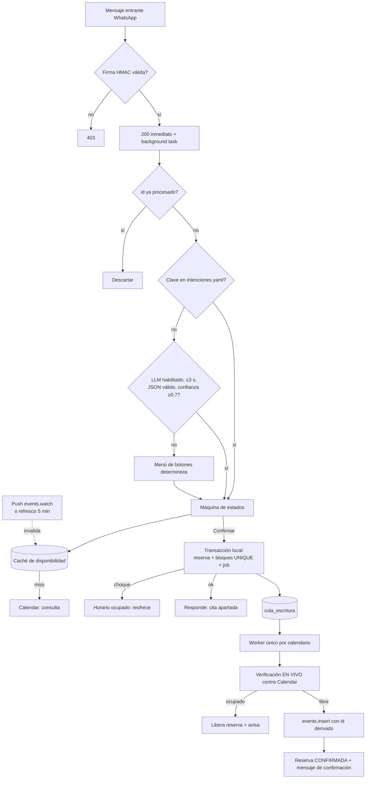
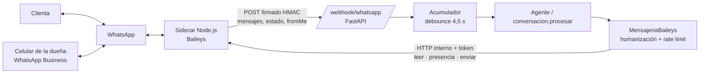
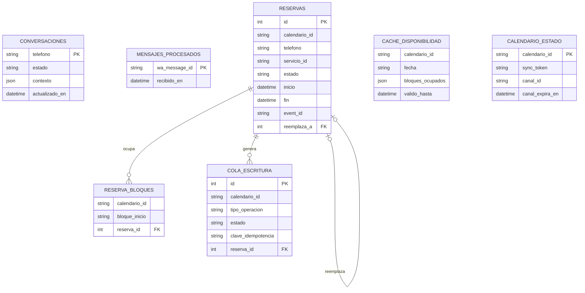
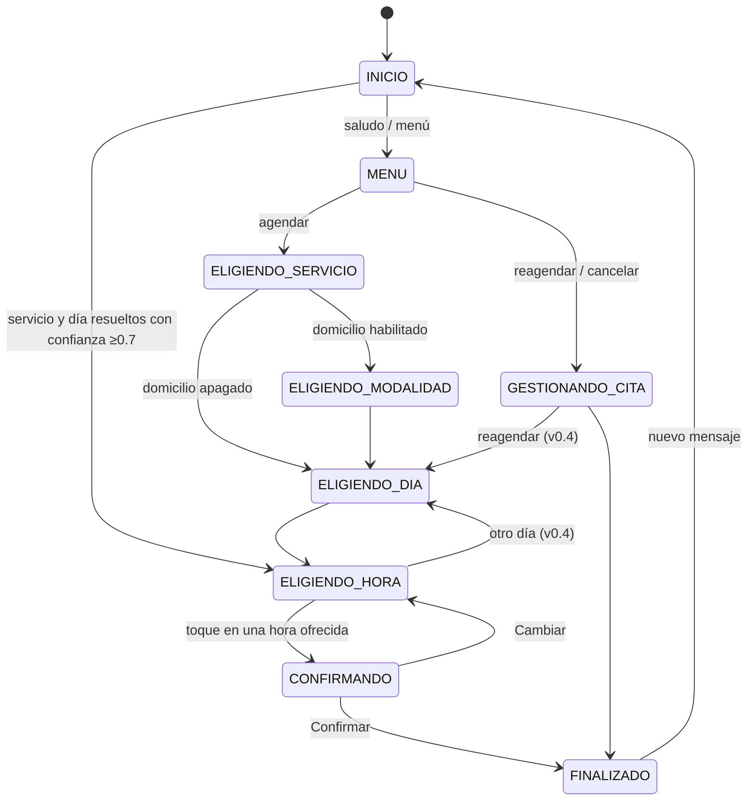

# SDD.md — Documento de Diseño de Software (Maestro)
## Agente de Agendamiento por WhatsApp para Manicurista Independiente
**Web/API (WhatsApp vía Baileys, sidecar) · LLM interpreta, código ejecuta · Mono-tenant (un negocio, calendario parametrizable)**

Versión 0.4 · Estado: **Aprobado (v0.3) + cambio de transporte autorizado por el usuario (v0.4, §20.2)**

> **Este documento se crea PRIMERO y completo.** Es la fuente única de verdad del proyecto.
> Ningún otro documento del harness (`requirements.md`, `TDD.md`, `design.md`, `PLAN_IMPLEMENTACION.md`,
> `tasks.md`, `FASE_TRACKING.md`, `AGENTS.md`) se genera hasta que el usuario apruebe este SDD (§20).
> Los demás documentos son **extractos derivados** de este; si el SDD cambia, se actualizan.
> Lo no confirmado por el usuario se marca `⚠️ POR CONFIRMAR` y se lleva a Preguntas Abiertas (§18).

---

## 1. Introducción

### 1.1 Contexto y objetivo de negocio
**Cliente final:** manicurista independiente en Colombia, una persona, citas individuales. Hoy agenda
manualmente por WhatsApp mientras trabaja.

**Dolor que paga el proyecto:** la **cita doble**. Dos clientas quedan agendadas a la misma hora porque la
manicurista respondió a una mientras atendía a la otra.

**Objetivo:** que las clientas puedan, por WhatsApp y sin intervención humana, consultar servicios, precios
y ubicación; agendar viendo solo horarios reales; reagendar y cancelar. Las citas viven en el Google
Calendar personal de la manicurista (visible en su celular sin instalar nada).

**Métricas base y metas** (`⚠️ POR CONFIRMAR` con la manicurista; no se inventan):
| Métrica | Base actual | Meta propuesta |
|---|---|---|
| Citas dobles por mes | ⚠️ POR CONFIRMAR | 0 atribuibles al sistema |
| Tiempo semanal respondiendo mensajes de agenda | ⚠️ POR CONFIRMAR | −70 % (propuesta) |
| % de conversaciones de agenda resueltas sin intervención humana | 0 % | ≥ 80 % (propuesta) |
| % de mensajes resueltos sin llamar al LLM | n/a | medido y registrado (sin meta fija) |

### 1.2 Propósito y alcance del documento
Cubre el diseño completo del sistema: bot de WhatsApp, cola de escritura a Calendar, caché de
disponibilidad, capa de intención con LLM y fallback, modo simulador (demo) y manuales. No cubre:
recordatorios proactivos, pagos, panel de administración web (ver §16).

### 1.3 Definiciones y siglas
| Término | Definición |
|---|---|
| Clienta | Persona que escribe por WhatsApp para agendar |
| Dueña / manicurista | Titular del negocio y del calendario |
| Operador / desarrollador | Quien despliega y mantiene el sistema |
| Cita doble | Dos citas activas que se solapan en tiempo en el mismo calendario |
| Bloque | Unidad mínima de agenda (30 min, parametrizable) |
| Reserva | Registro local de una cita (PENDIENTE, CONFIRMADA, CANCELANDO, CANCELADA, EXPIRADA, FALLIDA) |
| Ventana de servicio de 24 h | Periodo de Meta tras el último mensaje de la clienta en el que se puede responder con mensajes libres |
| Fallback | Menú de botones determinista, camino principal del que el LLM es un atajo |
| EARS | Easy Approach to Requirements Syntax |
| ADR | Registro de decisión de arquitectura |

---

## 2. Vista general del sistema

### 2.1 Contextos de uso (por dispositivo y rol)
| Contexto | Dispositivo | Usuario | Uso principal |
|---|---|---|---|
| Chat de WhatsApp | Celular | Clienta | Consultar, agendar, reagendar, cancelar |
| Google Calendar | App móvil de Calendar | Dueña | Ver citas; crear/mover eventos a mano |
| Archivos YAML de configuración | Editor de texto / repo | Dueña (guiada) u operador | Cambiar precios, horarios, mensajes, domicilio |
| `/health` y logs | Navegador / consola | Operador | Operación y diagnóstico |
| `/demo` (simulador) | Navegador, grabación vertical | Operador y cliente potencial | Demostración sin credenciales de Meta |

### 2.2 Roles del sistema
| Rol | Responsabilidades | Acceso |
|---|---|---|
| Clienta | Conversar con el bot | Solo su propia conversación y sus propias citas, identificada por teléfono |
| Dueña | Gestionar su calendario y configuración | Calendar (a mano) y YAML |
| Operador | Desplegar, rotar secretos, operar la cola | Servidor, variables de entorno, `/health` |
| Sistema (worker) | Única identidad que escribe en Calendar | Service account con permiso "Hacer cambios en los eventos" |

---

## 3. Arquitectura del sistema

### 3.1 Estilo arquitectónico
**Monolito modular con arquitectura hexagonal**, proceso único (`uvicorn --workers 1`). Puertos y
adaptadores para: WhatsApp (transporte), Calendar, LLM (`ProveedorLLM`), reloj. El dominio (conversación,
disponibilidad, reservas) no conoce FastAPI ni los SDK. Criterio según `DevSenPy`.

### 3.2 Componentes principales
| Componente | Responsabilidad | Tecnología |
|---|---|---|
| `webhook.py` | `POST /webhook/whatsapp` desde el sidecar: firma HMAC, filtro de chats, dedup, 200 inmediato, background task | FastAPI |
| `acumulador.py` | Debounce por teléfono: concatena mensajes seguidos y responde una vez | asyncio |
| `conversacion.py` | Máquina de estados por teléfono; **única** que decide transiciones | Python |
| `intencion.py` + `llm/` | Palabras clave → LLM → validación Pydantic → fallback | google-genai, Pydantic |
| `disponibilidad.py` | Cálculo de horarios ofrecibles desde bloques ocupados, margen y reservas locales | Python |
| `cache.py` | Caché por día con TTL, hit/miss, invalidación | SQLAlchemy |
| `cola.py` / `worker.py` | Cola en SQLite; un worker por calendario; backoff; pausa por cuota | asyncio, SQLAlchemy |
| `calendario.py` | Cliente Calendar v3 (freebusy/events, watch, sync token) con service account | google-api-python-client |
| `whatsapp.py` | `MensajeriaBaileys`: humanización (leído, escribiendo, pausa), menús numerados, rate limit, handoff humano; habla con el sidecar | httpx |
| `sidecar/` | Servicio Node.js con `@whiskeysockets/baileys`: sesión, reconexión, QR, leer/presencia/enviar, eventos | Node.js 22, TypeScript/JS |
| `modelos.py`, `config.py` | ORM y configuración validada (YAML + entorno) | SQLAlchemy 2, Pydantic Settings |
| `simulador/` | Transporte web `/demo` y calendario simulado | FastAPI + HTML/JS estático |

Estructura de carpetas: `app/` (main, webhook, conversacion, intencion, llm/, cola, worker, cache,
disponibilidad, calendario, whatsapp, modelos, config), `config/` (servicios, negocio, mensajes, faq,
intenciones `.yaml`), `tests/`, `.env.example`, `README.md`, `Makefile` (install, run, test, lint).

### 3.3 Diagramas

### 3.4 Patrones y decisiones clave
1. **El LLM interpreta, nunca ejecuta** (ADR-001).
2. **Anti-cita-doble en dos capas** (ADR-002): (a) transacción SQLite + UNIQUE por **bloque** (no solo por
   inicio) y (b) escritor único por calendario con verificación en vivo.
3. **Cola en SQLite**, sin Celery ni Redis (ADR-003). `BEGIN IMMEDIATE` en lugar de `SELECT … FOR UPDATE`.
4. **Idempotencia** en tres niveles: `wa_message_id`; `clave_idempotencia` de la cola (incluye `reserva_id`);
   `id` de evento Calendar derivado de `reserva_id`.
5. **Caché para ofrecer, nunca para escribir** (ADR-005).
6. **Resiliencia:** timeouts, backoff exponencial con jitter hacia Graph, Calendar y Gemini.
7. **Zona horaria fija** America/Bogota; persistencia en UTC.

### 3.5 Despliegue
- **Docker obligatorio** (imagen multi-stage, usuario no root, `HEALTHCHECK`, secretos por entorno).
- **Una sola instancia y un solo proceso** (restricción de diseño: el worker único y SQLite lo exigen).
- **Entornos:** local; **demo en Render** (`SIMULADOR=true`, `PROVEEDOR_LLM=none`, calendario simulado, sin
  credenciales de Meta/Google/Gemini); producción (proveedor ⚠️ POR CONFIRMAR, Render o Fly.io, con
  **disco persistente** y HTTPS público). Vercel descartado (ADR-007).
- Despliegue y push a `main` solo con confirmación explícita del usuario. Rollback: imagen anterior +
  backup del archivo SQLite.
- Push de Calendar requiere HTTPS público; si no está, **modo degradado** (refresco cada 5 min, §4.3).

---

### 3.6 Transporte de WhatsApp con Baileys (anti-bloqueo) — ADR-009
Cambio de requisito (v0.4): la dueña **no migra su número a la Cloud API** porque debe seguir usando la
aplicación de WhatsApp Business en su celular. El transporte pasa a un **sidecar Node.js** con
`@whiskeysockets/baileys` (WhatsApp Web multi-dispositivo, dispositivo vinculado por QR). **No cambia
nada del dominio:** `disponibilidad`, `cache`, `reservas`, `cola`, `worker`, `conversacion` y `agente`
siguen intactos; solo cambian los adaptadores de transporte detrás del puerto `Mensajeria`.

**Reparto de responsabilidades.** El sidecar es delgado: conexión, persistencia de credenciales,
reconexión, QR, y las tres primitivas (marcar leído, presencia, enviar). **Toda la política anti-bloqueo
vive en Python**, donde se prueba con reloj inyectable (`Reloj`/`Dormir`) sin dormir de verdad.

**Controles anti-bloqueo obligatorios**
1. *Comportamiento humano.* Al recibir: pausa aleatoria de 1,5 a 3 s y luego marcar leído; presencia
   `composing`; espera proporcional al texto (~45 ms por carácter, mínimo 2,5 s, máximo 6 s, jitter
   uniforme de −400 a +600 ms); presencia `paused` y envío único. En `SIMULADOR` o pruebas el retardo es 0.
2. *Botones y listas.* Baileys no garantiza el renderizado de mensajes interactivos nativos: todo
   `Saliente` de tipo `botones` o `lista` se degrada a **un solo texto numerado** ("1️⃣ … 2️⃣ …\n\nResponde con
   el número o el nombre de la opción"). La respuesta numérica o por nombre se mapea al `id_interactivo`
   ofrecido en ese mensaje; si no coincide con una opción ofrecida, se ignora. `CONFIRMANDO` sigue siendo
   alcanzable solo seleccionando una hora ofrecida (`contexto.horas_ofrecidas`).
3. *Sesión y red.* Credenciales persistentes en `/data/baileys_auth`; reconexión con backoff exponencial
   (2, 4, 8, 16, máx. 60 s + jitter) salvo `loggedOut` (401), que genera alerta `CRITICAL` y se expone en
   `/health`; versión desde `fetchLatestBaileysVersion()`, `browser: Browsers.macOS('Desktop')`,
   `syncFullHistory: false`; QR en consola o en un endpoint administrativo con token.
4. *Reglas de oro.* Tráfico 100 % entrante (nunca se escribe en frío); se ignoran grupos (`@g.us`),
   difusión (`status@broadcast`) y canales (`@newsletter`); *debounce* por teléfono (4,5 s) que concatena
   los mensajes seguidos y responde una sola vez; **intervención humana**: un mensaje `fromMe` cuyo id no
   emitió nuestro adaptador pausa el bot para ese teléfono (`pausa_intervencion_humana_minutos`, 120 por
   defecto); tope de respuestas por teléfono (15 por 10 min) y global.

**Riesgo aceptado y límites.** Baileys es una librería **no oficial** (no afiliada a WhatsApp) y su uso
automatizado puede contravenir los Términos de Servicio de WhatsApp: ningún control elimina el riesgo de
bloqueo del número. Los controles lo reducen; se documenta en el README y se deja la Cloud API como plan B
(el puerto `Mensajeria` permite volver sin tocar el dominio). La ventana de 24 h del worker se conserva
como regla propia: no se envían avisos si la clienta no escribió en las últimas 24 h.

---

## 4. Diseño de capacidades críticas

### 4.1 Capa de intención con LLM y fallback
- **Entrada al LLM (privacidad dura):** únicamente el texto del mensaje, el catálogo (id y nombre de
  servicios), la fecha de hoy con día de la semana y el **nombre del estado actual**
  (PA-04, cerrada: excepción mínima, sin identificadores). **Nunca:** teléfono, nombre, historial,
  dirección, ni identificador alguno.
- **Salida (Pydantic, `extra="forbid"`):** `intencion` ∈ {agendar, reagendar, cancelar, consultar_precio,
  consultar_horario, consultar_ubicacion, saludo, desconocida}; `servicio_id` (existente en catálogo o null);
  `fecha_tentativa` (fecha real o null); `franja` ∈ {manana, tarde, noche, null}; `confianza` ∈ [0,1].
- **Invalidación total** si hay campo extra, fecha imposible o `servicio_id` inexistente.
- **Fallback al menú** (la clienta nunca ve un error): timeout > 3 s; cuota/429/cualquier error del
  proveedor; JSON que no valida; confianza < 0.7. `PROVEEDOR_LLM=none` debe funcionar completo.
- **Ahorro de llamadas:** coincidencia por palabras clave en `config/intenciones.yaml` antes del LLM; se
  mide y registra el % resuelto sin LLM.
- Sin streaming. Modelo: Gemini Flash-Lite (nombre vigente ⚠️ POR CONFIRMAR en documentación oficial).
- La intención solo puede **proponer candidatos**; nunca produce transición a `CONFIRMANDO`.
- `GEMINI_TIER` en `.env`; el README explica que el tier gratuito usa el contenido para mejorar productos de
  Google y recomienda el de pago en producción, con estimación para 300 conversaciones al mes (cifras con
  precios vigentes, ⚠️ POR CONFIRMAR al redactar el README).

### 4.2 Cola de escritura con worker único por calendario
- Tabla `cola_escritura` (§6). Un worker asíncrono por `calendario_id`, arrancado en el lifespan de FastAPI,
  toma trabajos FIFO dentro de una transacción `BEGIN IMMEDIATE`.
- Backoff exponencial con jitter ≤ 1000 ms hasta 64 s; máximo 5 intentos; luego FALLIDA y alerta en log.
- Ante 403/429 con `usageLimits`, el worker **pausa la cola de ese calendario** (`cola_pausada_hasta`).
- **Reagendar** = una sola unidad de trabajo: crea el evento nuevo, luego elimina el anterior; si algo
  falla, revierte. La clienta nunca queda sin cita. (Alternativa más simple con `events.patch` en PA-06.)
- **Cancelar** pasa la reserva a CANCELANDO (sigue ocupando bloques) hasta que el worker elimina el evento.

### 4.3 Caché de disponibilidad con invalidación por push
- `cache_disponibilidad` por calendario y fecha, TTL 60 s configurable. Toda consulta de ofrecimiento pasa
  por el caché; un miss refresca desde el **espejo local de eventos** mantenido con `events.list` +
  `syncToken` (los sync tokens pertenecen a `events.list`, no a `freebusy`). Ante 410 se hace
  resincronización completa.
- Canal `events.watch` hacia `/webhook/calendar`; renovación automática antes de expirar. La notificación
  push avisa que algo cambió y no trae el cambio: se invalida el caché y se resincroniza.
- Sin push (local, sin HTTPS válido): refresco programado cada 5 min y log `modo_degradado`.
- **Regla crítica:** el caché solo sirve para OFRECER. La verificación final va siempre contra Calendar en
  vivo, dentro del worker.

### 4.4 Garantía anti-cita-doble
| Capa | Mecanismo | Qué cubre |
|---|---|---|
| 1 | Una transacción `BEGIN IMMEDIATE` inserta reserva + filas en `reserva_bloques` con `UNIQUE(calendario_id, bloque_inicio)`. Cada reserva ocupa *todos* los bloques que cubre (duración + margen [+ desplazamiento]) | Dos clientas simultáneas, incluso con servicios de distinta duración |
| 2 | Worker único por calendario + verificación en vivo contra Calendar antes de `events.insert` | Eventos creados a mano por la dueña; desfases del caché |
| Residual | Evento manual de la dueña creado en los milisegundos entre la verificación y el `insert` | Ventana de milisegundos; Calendar no impide solapes; la dueña lo ve en su celular. **Riesgo aceptado** (§14) |

### 4.5 Modalidad domicilio (parametrizable)
`config/negocio.yaml → domicilio.habilitado` (false por defecto). Apagado: no existe `ELIGIENDO_MODALIDAD`,
no se pide dirección, desplazamiento = 0. Encendido: se pregunta local/domicilio (solo para servicios en
`servicios_con_domicilio`), se pide dirección en texto libre (solo base local y campo `location` del evento;
nunca al LLM), se suman `minutos_desplazamiento` a los bloques ocupados y se **añade un recargo de
domicilio** (`recargo_cop`, entero en COP, definido por la manicurista). Zona de cobertura opcional.
Valores (PA-02, cerrada): desplazamiento 30 min aplicado una sola vez y sin zona por defecto; el
**recargo es obligatorio cuando `habilitado: true`** y su monto lo fija la manicurista en el YAML (si falta
o es negativo, el sistema no arranca). El recargo se informa a la clienta antes de confirmar
(servicio + recargo = total); el sistema no cobra ni procesa pagos.

---

## 5. Stack tecnológico
| Capa | Tecnología | Versión | Justificación |
|---|---|---|---|
| Lenguaje | Python | 3.12 | Obligatorio por el cliente |
| API | FastAPI + Uvicorn | ⚠️ fijar al construir | Obligatorio; background tasks y lifespan |
| WhatsApp | `@whiskeysockets/baileys` en un sidecar Node.js (reemplaza a la Cloud API, ADR-009) | ⚠️ fijar versión ≥ 6.7.22 o 7.0.0-rc12 (aviso de seguridad GHSA-qvv5-jq5g-4cgg) | La dueña conserva la app de WhatsApp Business en su celular |
| Runtime del sidecar | Node.js | 22 LTS | Requerido por Baileys |
| Calendario | Google Calendar API v3 + service account | — | Sin OAuth de usuario: no hay refresh tokens que manejar |
| LLM | `google-genai` tras `ProveedorLLM` | ⚠️ fijar al construir | Proveedor configurable por entorno |
| Persistencia | SQLite vía SQLAlchemy 2.x (modo WAL) | ⚠️ fijar | Una sola instancia; sin Redis/Celery |
| Validación | Pydantic v2 | ⚠️ fijar | Esquema estricto de intención y configuración |
| HTTP cliente | httpx | ⚠️ fijar | Timeouts y reintentos hacia el sidecar |
| Config | PyYAML, python-dotenv | ⚠️ fijar | YAML editable por la dueña |
| Calidad | pytest, pytest-asyncio, coverage, ruff, mypy | ⚠️ fijar | Gate de calidad |
| Contenedor | Docker multi-stage | — | Obligatorio |

Cada paquete nuevo se verifica en el registro oficial (PyPI) antes de instalarlo y se justifica en
`AI_PROCESS.md`. No se asumen nombres de endpoints ni campos: se consultan en documentación oficial
(`source-driven-development`).

---

## 6. Modelo de datos

### 6.1 Convenciones
Timestamps en UTC con zona; presentación en America/Bogota. Cuadrícula de bloques alineada a la hora local.
Teléfono en formato E.164 sin `+`. Precios en COP enteros. Sin borrado físico de reservas (cambian de
estado); sí se borran filas de `reserva_bloques` al liberar.

### 6.2 Entidades
| Entidad | Propósito | Campos principales |
|---|---|---|
| `conversaciones` | Estado por teléfono | `telefono` PK, `estado`, `contexto` JSON (servicio_id, fecha, modalidad, hora candidata), `actualizado_en` |
| `mensajes_procesados` | Deduplicación | `wa_message_id` PK, `recibido_en` |
| `reservas` | Cita lógica | `id`, `calendario_id`, `telefono`, `nombre_perfil`, `servicio_id`, `modalidad`, `direccion`, `inicio`, `fin`, `estado`, `event_id`, `expira_en`, `reemplaza_a`, `creado_en`, `actualizado_en` |
| `reserva_bloques` | Anti-solape | `calendario_id`, `bloque_inicio`, `reserva_id`; **UNIQUE(calendario_id, bloque_inicio)** |
| `cola_escritura` | Trabajos | `id`, `calendario_id`, `tipo_operacion` (CREAR/ACTUALIZAR/ELIMINAR/REAGENDAR), `payload` JSON, `estado`, `intentos`, `proxima_ejecucion`, `clave_idempotencia` UNIQUE, `resultado`, `reserva_id`, timestamps |
| `cache_disponibilidad` | Caché por día | `calendario_id`, `fecha`, `bloques_ocupados` JSON, `generado_en`, `valido_hasta` |
| `calendario_estado` | Sincronización y canal | `calendario_id` PK, `sync_token`, `canal_id`, `canal_resource_id`, `canal_expira_en`, `modo_degradado`, `cola_pausada_hasta` |
| `metricas` | Contadores | `nombre` PK, `valor` |

Reglas: la reserva ocupa bloques en estados PENDIENTE, CONFIRMADA y CANCELANDO. Bloques ocupados =
`ceil((duración + margen + desplazamiento) / bloque)`. Un servicio se ofrece solo si su **duración** termina
antes del cierre. Máximo 10 opciones por mensaje. `clave_idempotencia = hash(telefono, inicio,
tipo_operacion, reserva_id)`. PENDIENTE expira a los 10 min (tarea de limpieza cada 60 s) y solo protege
contra trabajos atascados (worker caído o cola pausada); al expirar libera bloques, cancela el job y avisa.

### 6.3 Relaciones
`reservas 1—N reserva_bloques`; `reservas 1—N cola_escritura`; `reservas 0..1—1 reservas` (`reemplaza_a`);
`conversaciones` ↔ `reservas` por teléfono (sin FK dura); `calendario_estado 1—N` el resto por `calendario_id`.

### 6.4 Diagrama entidad-relación

### 6.5 Clasificación de datos y normativa
| Dato | Clasificación | Normativa | Retención |
|---|---|---|---|
| Teléfono de la clienta | PII | Ley 1581 de 2012 (Habeas Data) | 12 meses desde la última cita (PA-05, cerrada) |
| Nombre de perfil de WhatsApp | PII | Ley 1581 | Igual que la reserva |
| Dirección de domicilio | PII | Ley 1581 | Se borra al cerrar la cita (PA-05, cerrada) |
| Texto del mensaje | PII potencial | Ley 1581 | **No se persiste**; solo en memoria durante el procesamiento |
| Historial de citas | Interno / PII | Ley 1581 | Igual que la reserva |
| Catálogo, horarios, mensajes | Público | — | Indefinida |
| Tokens (Meta, service account, Gemini) | Secreto | — | Solo variables de entorno |
| `wa_message_id` | Interno | — | 7 días (PA-05, cerrada) |

Obligaciones: autorización previa e informada para tratar datos personales. El primer contacto incluye un
aviso de tratamiento de datos con la política de la dueña (`⚠️ POR CONFIRMAR` el texto con asesoría legal;
PA-07). No aplica facturación DIAN (no se cobra ni se emiten documentos desde el sistema).

---

## 7. Diseño de API (preliminar)
| # | Método | Ruta | Request | Respuesta | Auth | Requisitos |
|---|---|---|---|---|---|---|
| 1 | GET | `/admin/whatsapp/qr` | cabecera `X-Admin-Token` | QR de vinculación (texto/PNG) o estado | Token administrativo | EARS-WA-14 |
| 2 | POST | `/webhook/whatsapp` | Evento del sidecar: mensaje, estado de conexión, `fromMe` | 200 siempre ≤ 5 s | `X-Firma` HMAC-SHA256 del cuerpo crudo (403 si falla) | EARS-WA-01..04 |
| 3 | POST | `/webhook/calendar` | Headers `X-Goog-*` | 200 | Token de canal propio | EARS-CAC-02 |
| 4 | GET | `/health` | — | JSON de métricas | Pública, sin datos personales | EARS-OBS-01 |
| 5 | GET | `/demo` | — | HTML del simulador | Solo con `SIMULADOR=true` | EARS-SIM-01 |
| 6 | POST | `/demo/api/mensaje` | `{telefono_demo, texto \| boton_id}` | Respuestas del bot | Solo simulador | EARS-SIM-02 |
| 7 | GET | `/demo/api/calendario` | — | Eventos simulados (+ SSE `/demo/api/eventos`) | Solo simulador | EARS-SIM-03 |
| 8 | POST | `/demo/api/carrera` | `{inicio, servicio_id}` | Resultado de dos confirmaciones simultáneas | Solo simulador | EARS-SIM-04 |
| 9 | POST | `/demo/api/reiniciar` | — | 204 | Solo simulador | EARS-SIM-05 |

Convenciones: sin versionado (API interna salvo los webhooks); errores en JSON `{codigo, mensaje}`;
idempotencia por `wa_message_id`; los endpoints `/demo/*` no existen si `SIMULADOR` no es `true`.

---

## 8. Experiencia de usuario y navegación

### 8.1 Mapa de navegación (conversación)

`ELIGIENDO_MODALIDAD` solo existe si el domicilio está habilitado. Reinicio a `INICIO` tras 30 min de
inactividad. Es imposible saltar `CONFIRMANDO`.

### 8.2 Flujos clave
1. **Agendar:** servicio → (modalidad) → día → hora → confirmar → "apartada" → "confirmada".
2. **Reagendar:** ve su cita futura → elige nueva hora → confirma → "reagendada".
3. **Cancelar:** ve su cita futura → confirma → "cancelada".
4. **Consultas:** precio, horario, ubicación y FAQ por palabras clave, sin LLM.

### 8.3 Pantallas
No hay pantallas para la clienta fuera de WhatsApp. **Simulador `/demo`:** chat estilo WhatsApp a la
izquierda, vista de calendario del día/semana a la derecha en vivo, botón "Dos confirmaciones
simultáneas", botón reiniciar; presentable en grabación vertical.

### 8.4 Directrices UX obligatorias
- Todo texto visible vive en `config/mensajes.yaml`; español colombiano, tuteando; cero strings en código.
- Botones para ≤ 3 opciones; listas para horarios y servicios en el simulador. En WhatsApp (Baileys) todo
  menú se envía como **texto numerado** y se acepta el número o el nombre de la opción (ADR-009).
- La clienta nunca ve un error técnico; ante fallo se muestra el menú o un mensaje amable.
- Simulador: contraste suficiente, tamaño táctil ≥ 44 px, responsivo vertical.

---

## 9. Historias de usuario
- **US-01:** *Como* clienta, *quiero* consultar servicios, precios, horario y ubicación por WhatsApp, *para* decidir sin esperar respuesta humana.
- **US-02:** *Como* clienta, *quiero* ver solo horarios realmente libres, *para* no quedar agendada en uno ocupado.
- **US-03:** *Como* clienta, *quiero* agendar una cita escribiendo en lenguaje natural o tocando botones, *para* hacerlo rápido.
- **US-04:** *Como* clienta, *quiero* reagendar mi cita sin perderla si algo falla, *para* no quedar sin turno.
- **US-05:** *Como* clienta, *quiero* cancelar mi cita, *para* liberar el espacio.
- **US-06:** *Como* clienta, *quiero* elegir atención en local o a domicilio cuando la dueña lo ofrezca, *para* la modalidad que me convenga.
- **US-07:** *Como* dueña, *quiero* que nunca haya dos citas a la misma hora, *para* dejar de tener cruces.
- **US-08:** *Como* dueña, *quiero* ver las citas en mi Google Calendar del celular y poder agendar a mano, *para* no instalar nada nuevo.
- **US-09:** *Como* dueña, *quiero* cambiar precios, horarios y activar el domicilio editando archivos sencillos, *para* no depender del desarrollador.
- **US-10:** *Como* operador, *quiero* ver métricas en `/health`, *para* detectar cola atascada o fallos.
- **US-11:** *Como* operador, *quiero* ejecutar todo sin LLM, *para* garantizar el servicio si el proveedor cae.
- **US-12:** *Como* operador, *quiero* un simulador con calendario en vivo y una prueba de carrera, *para* demostrar al cliente antes de tener credenciales de Meta.
- **US-13:** *Como* clienta, *quiero* que mis datos personales se traten con mi autorización, *para* proteger mi privacidad.
- **US-14:** *Como* dueña, *quiero* seguir usando WhatsApp Business en mi celular y que el bot se pause cuando yo le responda a una clienta, *para* no perder mi número ni pisar mis propias conversaciones.

---

## 10. Requisitos funcionales (EARS)

### 10.1 Webhook de WhatsApp (WA)
- **EARS-WA-01 (Event-driven):** Cuando el sidecar notifique un mensaje entrante a `/webhook/whatsapp`, el sistema deberá aceptarlo solo si la petición está firmada; en caso contrario, 403. (US-03)
- **EARS-WA-02 (Unwanted behavior):** Si la firma HMAC-SHA256 del cuerpo crudo no coincide con el secreto compartido, entonces el sistema deberá responder 403 sin procesar. (US-13)
- **EARS-WA-03 (Ubicuo):** El sistema deberá responder 200 en menos de 5 s siempre y procesar el mensaje en una background task. (US-03)
- **EARS-WA-04 (Event-driven):** Cuando llegue un mensaje con `id` ya registrado, el sistema deberá descartarlo sin efectos. (US-07)
- **EARS-WA-05 (Unwanted behavior):** Si el envío al sidecar falla, entonces el sistema deberá reintentar con backoff exponencial y registrar el fallo. (US-03)
- **EARS-WA-06 (Event-driven):** Cuando llegue un mensaje, el sistema deberá esperar un tiempo aleatorio de 1,5 a 3 s antes de marcarlo como leído. (US-14)
- **EARS-WA-07 (Event-driven):** Cuando marque el mensaje como leído, el sistema deberá enviar la presencia `composing` antes de responder. (US-14)
- **EARS-WA-08 (Ubicuo):** El sistema deberá esperar antes de enviar un tiempo proporcional al texto (45 ms por carácter, entre 2,5 y 6 s) más un jitter de −400 a +600 ms; con el reloj de pruebas o el simulador el retardo deberá ser 0. (US-14)
- **EARS-WA-09 (Ubicuo):** El sistema deberá enviar la presencia `paused` y despachar un único mensaje por respuesta de texto. (US-14)
- **EARS-WA-10 (Ubicuo):** El sistema deberá degradar botones y listas a un único texto numerado y mapear la respuesta numérica o por nombre al id ofrecido; una respuesta que no corresponda a una opción ofrecida no deberá cambiar el estado. (US-03)
- **EARS-WA-11 (Ubicuo):** El sistema deberá persistir las credenciales de sesión en el volumen `/data/baileys_auth` para no pedir un QR nuevo tras un reinicio. (US-14)
- **EARS-WA-12 (Unwanted behavior):** Si el WebSocket se desconecta por una causa distinta de `loggedOut`, entonces el sidecar deberá reconectar con backoff exponencial (2, 4, 8, 16 s, máximo 60 s) con jitter; si es `loggedOut`, deberá registrar una alerta `CRITICAL` y exponer el estado en `/health`. (US-10)
- **EARS-WA-13 (Ubicuo):** El sidecar deberá usar la versión de `fetchLatestBaileysVersion()`, `Browsers.macOS('Desktop')` y `syncFullHistory: false`. (US-14)
- **EARS-WA-14 (Optional):** Donde la sesión no esté vinculada, el sidecar deberá mostrar el QR en consola y en un endpoint administrativo protegido por token. (US-14)
- **EARS-WA-15 (Ubicuo):** El sistema deberá procesar solo chats individuales (`@s.whatsapp.net`), ignorar grupos, difusión y canales, y no iniciar nunca una conversación con un número que no haya escrito primero. (US-14)
- **EARS-WA-16 (State-driven):** Mientras lleguen mensajes del mismo teléfono dentro de la ventana de debounce (4,5 s), el sistema deberá reiniciar el temporizador, concatenarlos con salto de línea y responder una sola vez. (US-14)
- **EARS-WA-17 (Event-driven):** Cuando el sidecar reporte un mensaje `fromMe` cuyo id no emitió el sistema, este deberá pausar el bot para ese teléfono durante `pausa_intervencion_humana_minutos` y no responder en ese lapso. (US-14)
- **EARS-WA-18 (Unwanted behavior):** Si el bot ya envió el máximo de mensajes a un teléfono en la ventana (15 en 10 min) o el máximo global, entonces el sistema deberá dejar de responder hasta que la ventana se libere. (US-14)

### 10.2 Intención (INT)
- **EARS-INT-01 (Event-driven):** Cuando el texto coincida con palabras clave de `intenciones.yaml`, el sistema deberá resolver sin llamar al LLM. (US-01)
- **EARS-INT-02 (Event-driven):** Cuando no haya coincidencia y el LLM esté habilitado, el sistema deberá enviar al LLM únicamente texto, catálogo, fecha de hoy y nombre del estado. (US-13)
- **EARS-INT-03 (Unwanted behavior):** Si la respuesta del LLM no valida contra el esquema, entonces el sistema deberá descartarla completa y mostrar el menú de botones. (US-11)
- **EARS-INT-04 (Unwanted behavior):** Si hay timeout > 3 s, error del proveedor o confianza < 0.7, entonces el sistema deberá mostrar el menú de botones sin mensaje de error. (US-11)
- **EARS-INT-05 (Ubicuo):** El sistema deberá funcionar completo con `PROVEEDOR_LLM=none`. (US-11)
- **EARS-INT-06 (Ubicuo):** El sistema deberá medir y registrar el % de mensajes resueltos sin LLM. (US-10)
- **EARS-INT-07 (Ubicuo):** La intención nunca deberá causar la transición a `CONFIRMANDO` ni escribir en Calendar. (US-07)
- **EARS-INT-08 (Unwanted behavior):** Si el prompt fuera a incluir teléfono, nombre, historial o dirección, entonces el sistema deberá impedir el envío (test de contrato del prompt). (US-13)

### 10.3 Conversación (CON)
- **EARS-CON-01 (State-driven):** Mientras la clienta esté en un estado, el sistema deberá aceptar solo las transiciones definidas en §8.1. (US-03)
- **EARS-CON-02 (Event-driven):** Cuando pasen 30 min sin actividad, el sistema deberá reiniciar la conversación a `INICIO`. (US-03)
- **EARS-CON-03 (Event-driven):** Cuando servicio y día se resuelvan con confianza ≥ 0.7, el sistema podrá saltar de `INICIO` a `ELIGIENDO_HORA`, nunca a `CONFIRMANDO`. (US-03)
- **EARS-CON-04 (Optional):** Donde el domicilio esté habilitado y el servicio lo permita, el sistema deberá preguntar la modalidad. (US-06)
- **EARS-CON-05 (Ubicuo):** El sistema deberá usar botones para ≤ 3 opciones y listas para servicios y horarios. (US-03)
- **EARS-CON-06 (Event-driven):** Cuando una clienta nueva escriba por primera vez, el sistema deberá mostrar el aviso de tratamiento de datos antes de pedir datos. (US-13)
- **EARS-CON-07 (Unwanted behavior):** Si la clienta ya tiene el máximo de citas futuras configurado, entonces el sistema deberá ofrecerle reagendar o cancelar en lugar de agendar. (US-05)
- **EARS-CON-08 (Ubicuo):** El sistema deberá resolver FAQ por palabras clave de `faq.yaml` sin LLM. (US-01)

### 10.4 Disponibilidad (DIS)
- **EARS-DIS-01 (Ubicuo):** El sistema deberá ofrecer un horario solo si todos sus bloques están libres, la duración del servicio termina antes del cierre y respeta anticipación mínima (2 h) y ventana máxima (21 días). (US-02)
- **EARS-DIS-02 (Ubicuo):** El sistema deberá restar de la disponibilidad los eventos de Calendar, el margen y las reservas locales PENDIENTE, CONFIRMADA y CANCELANDO. (US-02)
- **EARS-DIS-03 (Ubicuo):** El sistema deberá ofrecer como máximo 10 opciones por mensaje. (US-02)
- **EARS-DIS-04 (Ubicuo):** El sistema deberá usar la zona America/Bogota y no ofrecer días no laborales. (US-02)

### 10.5 Reservas y cola (RES / COL)
- **EARS-RES-01 (Event-driven):** Cuando la clienta confirme, el sistema deberá insertar en **una sola transacción** la reserva PENDIENTE, sus filas de bloques y el trabajo CREAR. (US-07)
- **EARS-RES-02 (Unwanted behavior):** Si algún bloque ya está tomado, entonces el sistema deberá deshacer la transacción, informar que el horario se ocupó y reofrecer opciones. (US-07)
- **EARS-RES-03 (Unwanted behavior):** Si la clienta repite la confirmación de la misma reserva, entonces el sistema deberá devolver la reserva existente sin duplicar. (US-07)
- **EARS-RES-04 (Event-driven):** Cuando se cree la reserva, el sistema deberá responder de inmediato "cita apartada" y, al confirmar el worker, enviar la confirmación final. (US-03)
- **EARS-RES-05 (Unwanted behavior):** Si el trabajo falla definitivamente, entonces el sistema deberá liberar la reserva y avisar a la clienta. (US-07)
- **EARS-RES-06 (State-driven):** Mientras una reserva esté PENDIENTE más de 10 min sin completarse, el sistema deberá expirarla, liberar bloques y avisar. (US-07)
- **EARS-RES-07 (Event-driven):** Cuando la clienta reagende, el sistema deberá crear el evento nuevo antes de eliminar el anterior y revertir si algo falla, sin dejarla sin cita. (US-04)
- **EARS-RES-08 (Event-driven):** Cuando la clienta cancele, el sistema deberá marcar CANCELANDO y liberar bloques solo cuando el evento haya sido eliminado. (US-05)
- **EARS-RES-09 (Ubicuo):** El sistema deberá buscar las citas futuras de una clienta por `extendedProperties.private.telefono`. (US-04, US-05)
- **EARS-COL-01 (Ubicuo):** El sistema deberá tener un solo worker por `calendario_id`, nunca dos escrituras concurrentes sobre el mismo calendario. (US-07)
- **EARS-COL-02 (Ubicuo):** El sistema deberá derivar `clave_idempotencia` de teléfono, inicio, tipo y `reserva_id`, y usar un `id` de evento derivado de `reserva_id`. (US-07)
- **EARS-COL-03 (Unwanted behavior):** Si Calendar responde 5xx, 403 o 429, entonces el worker deberá reintentar con backoff exponencial, jitter ≤ 1000 ms y tope 64 s, máximo 5 intentos. (US-07)
- **EARS-COL-04 (Unwanted behavior):** Si Calendar responde 403/429 con `usageLimits`, entonces el worker deberá pausar la cola de ese calendario durante el backoff. (US-07)
- **EARS-COL-05 (Event-driven):** Antes de crear un evento, el worker deberá verificar en vivo contra Calendar que el rango está libre. (US-07, US-08)
- **EARS-COL-06 (Unwanted behavior):** Si la verificación en vivo detecta ocupación, entonces el trabajo deberá fallar sin reintentos y liberar la reserva. (US-07)

### 10.6 Caché y sincronización (CAC / CAL)
- **EARS-CAC-01 (Ubicuo):** El sistema deberá servir toda consulta de ofrecimiento desde el caché con TTL configurable (60 s por defecto); un miss deberá refrescar. (US-02)
- **EARS-CAC-02 (Event-driven):** Cuando llegue una notificación push de Calendar, el sistema deberá invalidar el caché del calendario y resincronizar. (US-08)
- **EARS-CAC-03 (Ubicuo):** El sistema deberá renovar el canal `events.watch` antes de que expire. (US-08)
- **EARS-CAC-04 (Unwanted behavior):** Si el push no está disponible, entonces el sistema deberá refrescar cada 5 min y registrar `modo_degradado`. (US-08)
- **EARS-CAC-05 (Unwanted behavior):** Si el sync token expira (410), entonces el sistema deberá hacer una resincronización completa. (US-08)
- **EARS-CAC-06 (Ubicuo):** El sistema nunca deberá crear ni modificar una cita basándose en datos cacheados. (US-07)
- **EARS-CAL-01 (Ubicuo):** Los eventos deberán incluir `extendedProperties.private` con teléfono y `reserva_id`, título con el servicio y nombre de perfil, y teléfono en la descripción. (US-08)
- **EARS-CAL-02 (Optional):** Donde la modalidad sea domicilio, el evento deberá incluir la dirección en `location`. (US-06)

### 10.7 Domicilio (DOM) y configuración (CFG)
- **EARS-DOM-01 (Optional):** Donde `domicilio.habilitado` sea true, el sistema deberá sumar el desplazamiento a los bloques ocupados y añadir el recargo de domicilio configurado al precio del servicio. (US-06, US-09)
- **EARS-DOM-04 (Optional):** Donde la modalidad elegida sea domicilio, el sistema deberá mostrar a la clienta el precio del servicio, el recargo y el total antes de pedir la confirmación, y registrar el recargo en la descripción del evento. (US-06)
- **EARS-DOM-05 (Unwanted behavior):** Si `domicilio.habilitado` es true y `recargo_cop` falta o es negativo, entonces el sistema deberá fallar al arrancar con un mensaje claro. (US-09)
- **EARS-DOM-02 (Unwanted behavior):** Si `domicilio.habilitado` es false, entonces el sistema no deberá mencionar ni solicitar datos de domicilio. (US-09)
- **EARS-DOM-03 (Optional):** Donde exista zona de cobertura, el sistema deberá rechazar con amabilidad direcciones fuera de ella. (US-06)
- **EARS-CFG-01 (Ubicuo):** El sistema deberá leer servicios, horario, mensajes, FAQ e intenciones desde `config/*.yaml` y validarlos al arrancar; si son inválidos, deberá fallar al iniciar con un mensaje claro. (US-09)
- **EARS-CFG-02 (Ubicuo):** Margen entre citas, calendario, máximo de citas por clienta, anticipación mínima de cancelación y TTL deberán ser parametrizables. (US-09)

### 10.8 Simulador (SIM) y observabilidad (OBS)
- **EARS-SIM-01 (Optional):** Donde `SIMULADOR=true`, el sistema deberá exponer `/demo`. (US-12)
- **EARS-SIM-02 (Optional):** Donde `SIMULADOR=true`, el transporte simulado deberá usar la misma lógica de conversación que WhatsApp. (US-12)
- **EARS-SIM-03 (Optional):** Donde `SIMULADOR=true`, el calendario simulado deberá actualizarse en vivo en la vista. (US-12)
- **EARS-SIM-04 (Optional):** Donde `SIMULADOR=true`, el botón de carrera deberá disparar dos confirmaciones simultáneas del mismo horario y mostrar que exactamente una gana. (US-12)
- **EARS-SIM-05 (Optional):** Donde `SIMULADOR=true`, deberá existir reinicio de estado de demo. (US-12)
- **EARS-OBS-01 (Ubicuo):** `/health` deberá exponer profundidad de cola, tasa de acierto del caché, % de mensajes sin LLM y trabajos fallidos. (US-10)

---

## 11. Requisitos no funcionales y seguridad

### 11.1 Requisitos no funcionales
| ID | Categoría | Especificación medible |
|---|---|---|
| NFR-REN-01 | Rendimiento | El webhook responde 200 en < 1 s (p95); jamás > 5 s |
| NFR-REN-02 | Rendimiento | Con caché caliente, 10 consultas del mismo día en 1 minuto generan 1 llamada a Calendar |
| NFR-REN-03 | Rendimiento | El LLM aborta a los 3 s y la clienta recibe el menú |
| NFR-DIS-01 | Disponibilidad | Con `PROVEEDOR_LLM=none` el flujo completo funciona (test E2E) |
| NFR-INT-01 | Integridad | 0 pares de reservas activas con bloques solapados (test de concurrencia con ≥ 50 intentos paralelos) |
| NFR-PRI-01 | Privacidad | El prompt al LLM no contiene PII (test de contrato) |
| NFR-PRI-02 | Privacidad | Teléfono enmascarado (últimos 4 dígitos) en logs; sin tokens ni contenido al LLM en logs de producción |
| NFR-SEG-01 | Seguridad | OWASP ASVS nivel 2 donde aplique (webhook, secretos, dependencias) |
| NFR-SEG-02 | Seguridad | Sin secretos en el repositorio; `.env.example` sin valores |
| NFR-DES-01 | Despliegue | Ejecutarse en contenedor Docker, usuario no root, `HEALTHCHECK` |
| NFR-MNT-01 | Mantenibilidad | Cero strings visibles en el código; todo en `mensajes.yaml` |
| NFR-CAL-01 | Calidad | Cobertura de ramas ≥ 85 % y 100 % en disponibilidad, reservas, cola y autorización por firma; type hints estrictos (mypy) y ruff limpio |
| NFR-OBS-01 | Observabilidad | Logs estructurados JSON con correlation id por mensaje |
| NFR-ANT-01 | Protección de la línea | Ninguna respuesta sale en menos de 2,5 s tras el mensaje entrante en producción; 0 mensajes a números que no escribieron primero; 0 respuestas a grupos, difusión o canales (tests con reloj inyectable) |

### 11.2 Matriz RBAC
| Permiso / acción | Clienta | Dueña | Operador | Worker |
|---|:---:|:---:|:---:|:---:|
| Agendar/reagendar/cancelar **sus** citas | ✅ | — | — | — |
| Ver citas de otras clientas | ❌ | ✅ (Calendar) | ✅ (BD) | — |
| Escribir en Calendar | ❌ | ✅ (a mano) | ❌ | ✅ (único automático) |
| Editar YAML de configuración | ❌ | ✅ | ✅ | — |
| Ver `/health` | ❌ | ❌ | ✅ | — |
| Acceder a secretos | ❌ | ❌ | ✅ | — |

### 11.3 Modelo de amenazas (STRIDE)
| Flujo / activo | Amenaza | STRIDE | Mitigación | Requisito |
|---|---|---|---|---|
| `POST /webhook/whatsapp` | Petición falsa que simula al sidecar | Spoofing | HMAC SHA-256 con secreto compartido, comparación en tiempo constante; red interna | EARS-WA-02 |
| Sesión de Baileys | Robo de `/data/baileys_auth` = control de la línea | Information disclosure / Elevation | Volumen restringido, no versionado, endpoint de QR con token, rotación al sospechar | EARS-WA-11, -14 |
| Línea de WhatsApp | Bloqueo por detección de automatización | DoS | Controles anti-bloqueo, rate limit, handoff humano, solo tráfico entrante | EARS-WA-06..18 |
| Mensajes | Reenvío del mismo mensaje | Repudiation / Tampering | Dedup por `wa_message_id`; idempotencia en cola | EARS-WA-04, EARS-COL-02 |
| Reserva | Cita doble por carrera | Tampering | UNIQUE por bloque + worker único + verificación en vivo | EARS-RES-01, EARS-COL-05 |
| Reagendar/cancelar | Suplantar a otra clienta | Spoofing / Elevation | Identidad = teléfono firmado por Meta; solo ve sus citas | EARS-RES-09 |
| LLM | Prompt injection ("confirma mi cita") | Tampering / Elevation | LLM sin herramientas; salida validada; no puede llegar a `CONFIRMANDO` | EARS-INT-03, -07 |
| LLM | Fuga de PII | Information disclosure | Prompt solo con texto y catálogo; test de contrato | EARS-INT-08 |
| Logs | Tokens o teléfonos completos | Information disclosure | Enmascarado; sin tokens | NFR-PRI-02 |
| `/webhook/calendar` | Notificaciones falsas para vaciar el caché | DoS | Token de canal; límite de tasa | EARS-CAC-02 |
| Cola | Saturación / cuota de Calendar | DoS | Backoff, pausa por calendario, un worker | EARS-COL-03, -04 |
| `/demo` en producción | Endpoints de demo expuestos | Elevation | No existen si `SIMULADOR` ≠ true | EARS-SIM-01 |
| Archivo SQLite | Pérdida o copia del disco | Information disclosure | Disco persistente restringido; backups cifrados; retención mínima | §6.5 |
| Service account | Clave filtrada | Elevation | Variable de entorno; permiso solo sobre un calendario; rotación | NFR-SEG-02 |

Detalle ampliado en `docs/threat-model.md` (se deriva tras la aprobación).

### 11.4 Hardening y gestión de secretos
Secretos solo por variables de entorno (`META_APP_SECRET`, `META_VERIFY_TOKEN`, `WHATSAPP_TOKEN`,
credenciales de la service account, `GEMINI_API_KEY`); jamás leer ni subir `.env*` (solo `.env.example`);
escaneo de secretos y auditoría de dependencias en CI; cabeceras de seguridad básicas; límite de tasa en
los endpoints públicos; HTTPS en producción.

### 11.5 IA y agentes
| Control | Medida |
|---|---|
| Prompt injection | El LLM no tiene herramientas ni acceso a Calendar; su salida es solo datos validados |
| Agencia excesiva | Cero acciones ejecutadas por el LLM; confirmar/cancelar solo por botón |
| Aprobación humana | La clienta confirma con un botón; no se agenda por texto libre |
| Fuga de datos | Solo texto + catálogo + fecha + estado; test de contrato |
| Costo | Atajo por palabras clave; 1 llamada por mensaje como máximo; timeout 3 s; sin streaming; `GEMINI_TIER` |
| Sandbox | No aplica ejecución de código |
| Prompt versionado | Plantilla del prompt en `config/` y versionada en el repo, y evals con un set de frases de ejemplo |

---

## 12. Observabilidad
Logs JSON con correlation id, teléfono enmascarado. Métricas en `/health`: profundidad de cola, tasa de
acierto del caché, % de mensajes resueltos sin LLM, trabajos fallidos, modo degradado del canal, expiración
del canal, pausa de cola. Alertas en el log (nivel ERROR) cuando un trabajo pasa a FALLIDA. Trazas no
aplican en MVP (monolito de un proceso); health check apto para `HEALTHCHECK` de Docker.

---

## 13. Proceso de desarrollo

### 13.1 Metodología y fases
Orden pedido por el cliente, corriendo los tests tras cada bloque:
1. Modelos y config → 2. Disponibilidad → 3. Caché → 4. Cola y worker → 5. Máquina de estados →
6. Simulador → 7. Capa de intención → 8. Integración WhatsApp → 9. Integración push de Calendar →
10. README (técnico + manual para la clienta) → 11. Despliegue de la demo.
Criterio de desbloqueo: gate del bloque al 100 % antes de pasar al siguiente. Un esqueleto del simulador
se levanta temprano (PA-01).

### 13.2 Plan de pruebas y quality gate
- No se avanza con pruebas fallidas. Base de datos SQLite efímera real; Calendar simulado con
  respuestas controladas (429, 403, 5xx, 410); HTTP simulado para Graph y Gemini.
- Matriz de escenarios críticos:

| Módulo | Tipo | Casos principales | Criterio de éxito |
|---|---|---|---|
| Reservas | Concurrencia | Dos clientas confirman el mismo horario en paralelo; servicios de distinta duración solapados | Exactamente una gana; la otra recibe "horario ocupado" |
| Webhook | Idempotencia | Mismo webhook entregado dos veces | Un solo evento |
| Cola | Resiliencia | 429 simulado con backoff | Reintenta y crea el evento una sola vez |
| Cola | Resiliencia | Worker cae tras `insert` y antes de guardar `event_id` | El reintento no duplica (409 tratado como éxito) |
| Verificación en vivo | Integración | La dueña crea un evento a mano en el hueco | El trabajo falla, se libera y se avisa |
| Intención | Contrato | Esquema inválido, fecha imposible, servicio inexistente, confianza 0.69, timeout | Fallback al menú |
| Intención | Privacidad | Inspección del prompt | Sin teléfono, nombre ni dirección |
| Flujo | E2E | Agendar de punta a punta con `PROVEEDOR_LLM=none` | Pasa |
| Caché | Integración | 10 consultas del mismo día | 1 llamada a Calendar; invalidación por push |
| Reagendar | Integración | Fallo al eliminar la anterior; fallo al crear la nueva | Clienta conserva su cita |
| Máquina de estados | Unitaria | Ninguna ruta llega a `CONFIRMANDO` sin selección de hora | Pasa |
| Domicilio | Unitaria | Interruptor encendido/apagado | Flujo correcto en ambos |
| Simulador | E2E | Botón de carrera | Una cita y un rechazo visibles |

- Umbrales: 100 % de tests en verde por tarea; cobertura de ramas **medida** ≥ 85 % general y 100 % en
  disponibilidad, reservas, cola y verificación de firma.
- Herramientas: pytest, pytest-asyncio, coverage, ruff, mypy.

### 13.3 Repositorio, GitFlow y auditoría de IA
Repositorio ⚠️ POR CONFIRMAR (PA-09). GitFlow: `main`, `develop`, `feature/TASK-XX`, `release/vX.Y.Z`,
`hotfix/*`. Conventional Commits. Cada interacción se registra en `AI_PROCESS.md`. Nada de push o merge a
`main` sin confirmación.

---

## 14. Riesgos técnicos
| Riesgo | Prob. | Impacto | Mitigación | Dueño |
|---|---|---|---|---|
| Evento manual de la dueña en la ventana de milisegundos entre verificación e `insert` | Baja | Medio | Riesgo aceptado; la dueña lo ve en su calendario; verificación en vivo lo reduce | Operador |
| Más de una instancia/proceso rompe la serialización | Media | Alto | `--workers 1`, una instancia, documentado y chequeo al arrancar | Operador |
| Pérdida del disco SQLite | Media | Alto | Disco persistente + backup periódico; el calendario es reconstruible desde `extendedProperties` | Operador |
| Canal push caduca o no hay HTTPS | Media | Medio | Renovación automática; modo degradado de 5 min | Operador |
| Cuota de Calendar o Gemini agotada | Media | Medio | Backoff, pausa de cola, fallback | Operador |
| Bloqueo del número por Meta (Baileys es no oficial y puede contravenir los ToS de WhatsApp) o cambios de protocolo | Media | Alto | Controles anti-bloqueo (§3.6), solo tráfico entrante, handoff humano; versión fijada ≥ 6.7.22; plan B: Cloud API tras el mismo puerto `Mensajeria`; la dueña acepta el riesgo | Dueña / Operador |
| La dueña aún no vincula el dispositivo (QR) | Alta | Medio | Modo simulador para la demo; endpoint de QR con token | Operador |
| Incumplimiento de Habeas Data | Media | Alto | Aviso y autorización; retención mínima; asesoría legal | Dueña |
| Mensajes en frío por avisos tardíos del worker | Media | Alto | Solo avisos dentro de las 24 h posteriores al último mensaje de la clienta; sin recordatorios proactivos | Operador |

---

## 15. Casos límite (edge cases)
1. Dos clientas confirman el mismo horario a la vez → una gana, la otra ve "horario ocupado" y nuevas opciones.
2. Cita de 150 min solapada con una de 30 min que empieza dentro de ella → el segundo intento choca por bloques.
3. Meta reenvía el mismo webhook → un solo efecto.
4. La clienta toca "Confirmar" dos veces → una sola reserva.
5. Calendar da 429 durante la creación → backoff y un solo evento.
6. La dueña agenda a mano justo en el hueco ofrecido → la verificación en vivo falla; se libera y se avisa.
7. La clienta abandona antes de confirmar → no hay reserva; no se bloquea nada.
8. Worker caído o cola pausada > 10 min → la reserva PENDIENTE expira y se avisa.
9. LLM devuelve JSON válido pero `servicio_id` inexistente → se descarta toda la respuesta.
10. La clienta pide "mañana" con texto ambiguo → se muestra el menú o se pregunta el día con botones.
11. Pasa más de 24 h desde su último mensaje cuando el worker termina → solo se escribe en el log (no se puede enviar libre ni se usan plantillas); la cita queda confirmada en Calendar.
12. Cancelar mientras la creación del evento está en cola → CANCELANDO tras el CREAR; ELIMINAR se encola detrás.
13. Reagendar a un horario que se solapa con su propia cita actual → los bloques propios se transfieren en la misma transacción.
14. Cierre del negocio pocos minutos después de la última hora ofrecida → no se ofrece si la duración no cabe.
15. Cambio de horario de verano: Colombia no lo tiene; zona fija America/Bogota.
16. El archivo YAML queda inválido → el sistema no arranca y explica la línea errónea.
17. Domicilio activado con servicios que no lo permiten → solo se ofrece local para esos.
18. Mensaje no textual (audio, imagen) → respuesta amable con el menú.
19. Número con 2 citas futuras (límite) pide agendar → se le ofrece reagendar o cancelar.
20. El sync token de Calendar expira (410) → resincronización completa.

---

## 16. Fuera de alcance (MVP)
- ❌ Recordatorios proactivos: requieren plantillas aprobadas y generan costo por conversación; se documentan como extensión futura.
- ❌ Pagos, anticipos y facturación (no hay flujo de dinero en el sistema).
- ❌ Múltiples manicuristas en el flujo (la parametrización por `calendario_id` lo permite a futuro).
- ❌ OAuth de usuario de Google (se usa service account).
- ❌ Celery, Redis o cola externa.
- ❌ Panel web de administración (se edita YAML).
- ❌ Streaming del LLM.
- ❌ Alta disponibilidad / múltiples instancias.
- ❌ Notificaciones a la dueña por WhatsApp (ella ve el Calendar).

---

## 17. Criterios de aceptación y Definition of Done
Una tarea está terminada cuando: su test pasa al 100 %; ruff y mypy limpios; cobertura de ramas **medida**
cumple §13.2; sin secretos; casos límite relacionados cubiertos; bitácora en `AI_PROCESS.md`; commit
convencional mergeado a `develop` por `--no-ff`. Un bloque se cierra con `/agent-skills:review` sin hallazgos
críticos ni altos. Una versión se lanza con CI en verde, `/health` operativo, runbook, CHANGELOG, plan de
rollback probado, README (técnico y manual para la clienta) y go explícito del usuario.

**Criterios de aceptación del producto:** el test de carrera pasa; el flujo de agendar corre de punta a punta
con `PROVEEDOR_LLM=none`; el mismo webhook dos veces produce un solo evento; un 429 simulado termina en un
solo evento; el simulador muestra la carrera con una ganadora y un rechazo.

---

## 18. Preguntas abiertas
| ID | Pregunta / decisión | Estado | Resolución acordada |
|---|---|---|---|
| PA-01 | Orden del simulador | Cerrada | Orden de la lista, con esqueleto temprano |
| PA-02 | Valores de domicilio | Cerrada | Desplazamiento 30 min aplicado una sola vez, sin zona por defecto; **recargo obligatorio y parametrizable por la manicurista** (ver PA-15 para el monto). Todo en `negocio.yaml` |
| PA-03 | Margen entre citas | Cerrada | Parametrizable; 15 min inicial |
| PA-04 | Enviar al LLM el nombre del estado actual (sin PII) | Cerrada | Sí |
| PA-05 | Retención de datos (citas, dirección, ids de mensajes) | Cerrada | Citas 12 meses desde la última; dirección se borra al cerrar la cita; ids de mensaje 7 días |
| PA-06 | Reagendar con crear+eliminar vs `events.patch` | Cerrada | Spec original (crear nueva, eliminar anterior, revertir si falla) |
| PA-07 | Texto del aviso de tratamiento de datos (Ley 1581) | Cerrada (acción diferida) | Se redacta un borrador en `config/mensajes.yaml`; una persona con criterio legal lo revisa antes de producción (condición del go-live, §17) |
| PA-08 | Reservar la hora al entrar en `CONFIRMANDO` en vez de al confirmar | Cerrada | Al confirmar (spec) |
| PA-09 | Repositorio (URL) y proveedor de producción (Render o Fly.io) | Cerrada (acción diferida) | Demo en Render; repositorio y proveedor de producción se definen antes del lanzamiento (condición del go-live) |
| PA-10 | Métricas base del negocio (§1.1) | Cerrada (acción diferida) | Se levantan con la manicurista; se registran en §1.1 y en `AI_PROCESS.md` antes del go-live para poder medir el resultado (fase 7) |
| PA-11 | Nombre vigente del modelo Flash-Lite, límites de botones/listas, forma de `events.watch`, restricciones de `syncToken`, precios | Cerrada (acción diferida) | Se verifican en documentación oficial en cada bloque, antes de escribir el código que las usa |
| PA-12 | Reglas de cancelación | Cerrada | Sin mínimo, máx. 2 citas futuras (parametrizable) |
| PA-13 | Nombre de perfil en título y teléfono en descripción | Cerrada | Sí |
| PA-14 | Mensajes al confirmar | Cerrada | Dos (apartada, confirmada) dentro de la ventana de 24 h |
| PA-15 | Monto del recargo de domicilio en COP | Cerrada (acción diferida) | Lo define la manicurista. La demo usa un valor de ejemplo claramente marcado; producción exige el valor real (EARS-DOM-05) |

---

## 19. Registro de decisiones (ADR)
| ADR | Título | Estado | Fecha |
|---|---|---|---|
| ADR-001 | El LLM interpreta, nunca ejecuta | Propuesta | 2026-10-30 |
| ADR-002 | Anti-cita-doble por bloques (UNIQUE por bloque) + escritor único; no solo UNIQUE por inicio | Propuesta | 2026-10-30 |
| ADR-003 | Cola en SQLite con `BEGIN IMMEDIATE`, un proceso, un worker por calendario | Propuesta | 2026-10-30 |
| ADR-004 | Idempotencia con `reserva_id` en la clave y `id` de evento derivado | Propuesta | 2026-10-30 |
| ADR-005 | Caché con espejo `events.list`+`syncToken`; push para invalidar; verificación en vivo siempre | Propuesta | 2026-10-30 |
| ADR-006 | Domicilio como interruptor de configuración | Propuesta | 2026-10-30 |
| ADR-007 | Demo y producción en Render (disco persistente, una instancia); Vercel descartado por funciones efímeras y disco de solo lectura | Propuesta | 2026-10-30 |
| ADR-008 | Estado CANCELANDO que conserva bloques hasta que el evento se elimina | Propuesta | 2026-10-30 |
| ADR-009 | Transporte WhatsApp vía Baileys con controles anti-ban, debounce, handoff humano y menús numerados para conservar la app móvil de la dueña (`docs/adr/0002-transporte-baileys.md`) | Autorizada por el usuario | 2026-10-30 |

---

## 20. Validación y aprobación humana (compuerta obligatoria)

> El agente presenta el SDD y **se detiene**. Solo el usuario marca estas casillas.
> Ningún otro documento del harness se genera hasta que el usuario apruebe el SDD.

### 20.1 Checklist de completitud
> Marcado el 2026-10-30 por el agente, por instrucción explícita del usuario en el chat ("Apruebo SDD v0.3").

- [x] Contexto, objetivo y métricas base claros (§1)
- [x] Contextos de uso y roles definidos (§2)
- [x] Arquitectura, componentes, patrones y despliegue en Docker (§3)
- [x] Capacidades críticas diseñadas, si aplican (§4)
- [x] Stack con versiones y justificación (§5)
- [x] Modelo de datos completo con ERD y clasificación de datos y normativa (§6)
- [x] API preliminar con todos los endpoints numerados (§7)
- [x] Navegación, flujos y directrices UX (§8)
- [x] Historias de usuario con ID por rol (§9)
- [x] Requisitos EARS con ID por dominio, todos trazables a una US (§10)
- [x] NFR medibles con ID, matriz RBAC y modelo de amenazas STRIDE (§11)
- [x] Observabilidad definida (§12)
- [x] Plan de pruebas con umbrales de cobertura medida (§13)
- [x] Riesgos, casos límite y fuera de alcance (§14 a §16)
- [x] Definition of Done (§17)
- [x] Ninguna pregunta abierta bloqueante en §18 (las acciones diferidas quedan como condiciones de go-live o de cada bloque)

### 20.2 Registro de aprobación
| Versión | Fecha | Aprobado por | Observaciones |
|---|---|---|---|
| 0.3 | 2026-10-30 | Usuario (chat: "Apruebo SDD v0.3") | Acciones diferidas: PA-07, PA-09, PA-10, PA-11, PA-15 |
| 0.4 | 2026-10-30 | Usuario (chat: "autorizo formalmente … una actualización de arquitectura" con el puente Baileys) | Cambio de transporte (ADR-009). El texto resultante lo redactó el agente a partir de esa instrucción; **queda pendiente la lectura y confirmación explícita del usuario** |

---

## 21. Historial de cambios
| Versión | Fecha | Cambio | Documentos derivados actualizados |
|---|---|---|---|
| 0.1 | 2026-10-30 | Versión inicial a partir del prompt del cliente y las decisiones de la sesión de diseño | — |
| 0.3 | 2026-10-30 | Se cierran PA-07, PA-09, PA-10, PA-11 y PA-15 aceptando las recomendaciones (acciones diferidas a go-live o a cada bloque); sin cambios de diseño | — |
| 0.4 | 2026-10-30 | ADR-009: transporte WhatsApp con Baileys y controles anti-bloqueo (§3.6); EARS-WA-01..05 reescritos y EARS-WA-06..18 nuevos; US-14; NFR-ANT-01; API §7 (webhook del sidecar y QR); riesgos y amenazas; aclaración de §8.1 (ELIGIENDO_HORA→ELIGIENDO_DIA, GESTIONANDO_CITA→ELIGIENDO_DIA, vuelta al menú) | `requirements.md`, `design.md`, `TDD.md`, `PLAN_IMPLEMENTACION.md`, `tasks.md`, `FASE_TRACKING.md`, ADR 0002 |
| 0.2 | 2026-10-30 | Recargo de domicilio obligatorio y parametrizable por la manicurista (§4.5, EARS-DOM-01/04/05, PA-02, PA-15); se cierran PA-04, PA-05, PA-06, PA-08 con los defaults propuestos | — |

---

## Anexos
- Prompt original del cliente: registrado literalmente en `AI_PROCESS.md`, Entrada 1.
- Referencias a verificar en documentación oficial antes de implementar: Baileys (README y baileys.wiki:
  conexión, `useMultiFileAuthState`, `connection.update`, `messages.upsert`, presencia), la Cloud API solo como plan B, Google Calendar API v3 (`events.insert` con `id`, `events.list` con
  `syncToken`, `events.watch`, `freebusy.query`, cuotas), `google-genai` (salida estructurada, timeouts).
