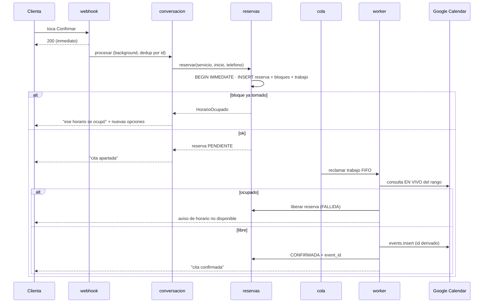

# TDD.md — Documento de Diseño Técnico
## AgenteManiculista

> **Documento derivado del `SDD.md` aprobado** (§3 a §7, §11 a §13). Baja el diseño a decisiones de
> implementación, sin cambiar requisitos. `design.md` es el extracto operativo que el agente lee por bloque.
> **Solo lectura para el agente** sin orden del usuario.
>
> Versión del SDD de origen: 0.3

## 1. Stack tecnológico
| Capa | Tecnología | Versión | Justificación |
|---|---|---|---|
| Lenguaje | Python | 3.12 | Obligatorio por el cliente |
| API | FastAPI + Uvicorn | ⚠️ fijar en `pyproject.toml` al TASK-02, verificando PyPI | Obligatorio |
| ORM | SQLAlchemy 2.x (sync + sqlite3) | ⚠️ ídem | Cola y reservas con `BEGIN IMMEDIATE`; el worker corre sus operaciones de BD con `asyncio.to_thread` |
| Validación | Pydantic v2, pydantic-settings | ⚠️ ídem | Esquema estricto de intención y configuración |
| HTTP | httpx | ⚠️ ídem | Timeouts, reintentos, mockeable |
| Calendar | google-api-python-client + google-auth | ⚠️ ídem | Service account; verificar en documentación oficial el cliente async/sync |
| LLM | google-genai | ⚠️ ídem | Detrás de `ProveedorLLM` |
| Config | PyYAML, python-dotenv | ⚠️ ídem | YAML editable por la dueña |
| Calidad | pytest, pytest-asyncio, pytest-cov, ruff, mypy, pip-audit | ⚠️ ídem | Gate de calidad |
| Contenedores | Docker (multi-stage) | imagen base fijada | Obligatorio |
| CI/CD | GitHub Actions (si el repositorio se aloja en GitHub; PA-09) | — | Lint, tipos, tests, auditoría, escaneo de secretos |

Ninguna versión se asume: se resuelven en TASK-02 contra el registro oficial y quedan fijadas con lockfile.

## 2. Estructura del repositorio
```
AgenteManiculista/
├── AGENTS.md  CLAUDE.md  CONSTRAINTS.md  SDD.md  TDD.md  requirements.md  design.md
├── PLAN_IMPLEMENTACION.md  tasks.md  FASE_TRACKING.md  AI_PROCESS.md
├── pyproject.toml  Makefile  Dockerfile  docker-compose.yml  render.yaml  .env.example  README.md
├── app/
│   ├── main.py  config.py  modelos.py  puertos.py  reloj.py  metricas.py  mensajes.py
│   ├── webhook.py  conversacion.py  intencion.py  llm/{__init__,base,ninguno,gemini}.py
│   ├── disponibilidad.py  reservas.py  cache.py  cola.py  worker.py
│   ├── calendario.py  whatsapp.py
│   └── simulador/{transporte.py,calendario_falso.py,rutas.py,static/}
├── config/{servicios,negocio,mensajes,faq,intenciones}.yaml
├── tests/{unit,integration,e2e}/
└── docs/{adr,threat-model.md,runbook.md,manual-clienta.md}
```
`app/` conserva los módulos planos que pidió el cliente. La arquitectura hexagonal se aplica por **puertos**
(`app/puertos.py`: `Calendario`, `Mensajeria`, `ProveedorLLM`, `Reloj`) y adaptadores (`calendario.py`,
`whatsapp.py`, `llm/*`, `simulador/*`). El dominio (`conversacion`, `disponibilidad`, `reservas`, `cola`) solo
depende de puertos.

## 3. Diseño por módulo
| Módulo | Responsabilidad | Puertos / patrones |
|---|---|---|
| `config.py` | Cargar y validar YAML y entorno; falla al arrancar si son inválidos | Pydantic; Singleton inmutable |
| `modelos.py` | ORM, engine con WAL y `BEGIN IMMEDIATE`, tipo de fecha UTC | Repository ligero |
| `disponibilidad.py` | Cuadrícula de bloques, bloques ocupados por servicio, horarios ofrecibles | Funciones puras |
| `cache.py` | Caché por día con TTL, métricas, invalidación; espejo de eventos con `syncToken` | Cache-aside |
| `reservas.py` | Transacción de reserva (reserva + bloques + trabajo), cancelar, reagendar, expirar | Unit of Work |
| `cola.py` / `worker.py` | Encolar, reclamar FIFO, ejecutar, backoff, pausa; un worker por calendario | Outbox, Worker |
| `calendario.py` | Adaptador Google Calendar v3 (service account) | Adapter del puerto `Calendario` |
| `conversacion.py` | Máquina de estados; único módulo que decide transiciones | State |
| `intencion.py`, `llm/` | Palabras clave → LLM → validación → fallback | Strategy (`ProveedorLLM`), Chain |
| `whatsapp.py` | `MensajeriaBaileys`: humanización, menús numerados, rate limit; habla con el sidecar (v0.4, ADR-009) | Adapter del puerto `Mensajeria` |
| `acumulador.py` | Debounce por teléfono | Buffer asíncrono |
| `sidecar/` | Servicio Node.js con Baileys (sesión, QR, leer/presencia/enviar) | Sidecar en su propio contenedor |
| `webhook.py` | POST del sidecar con firma HMAC, filtro de chats, dedup, background | Entrypoint |
| `simulador/` | Transporte web, calendario simulado en memoria, UI `/demo` | Adapter de `Mensajeria` y `Calendario` |

### Recorrido de una confirmación


## 4. Modelo físico de datos
DDL completo en `design.md` §2. SQLite en modo WAL, `busy_timeout`, claves foráneas activas. Fechas como
texto ISO-8601 UTC (`TypeDecorator` que convierte desde y hacia `datetime` con zona). Migraciones: Alembic
**no** se incluye en el MVP; el esquema se crea con `create_all` y las versiones futuras se tratan con
`deprecation-and-migration` (expand/contract) cuando exista un dato real en producción (ADR-009 pendiente).

## 5. Contratos de API
Ver SDD §7 y `design.md` §Bn.3. Webhooks de Meta y Google según su especificación oficial (verificar). Errores
propios en JSON `{codigo, mensaje}`. Sin paginación (sin listados públicos). Idempotencia por `wa_message_id`.

## 6. Seguridad técnica
- Firma HMAC SHA-256 con comparación en tiempo constante (`hmac.compare_digest`) sobre el cuerpo crudo.
- Sin autenticación de usuario: la identidad de la clienta es el teléfono entregado por el sidecar en un webhook firmado (HMAC).
- Token de canal en `/webhook/calendar`; `/demo/*` solo existe con `SIMULADOR=true`.
- Secretos solo por entorno; la service account se entrega como JSON en variable o ruta a archivo montado.
- Cabeceras de seguridad básicas y límite de tasa por IP en los endpoints públicos.

## 7. Manejo de errores y observabilidad
Jerarquía: `ErrorApp` → `ConfiguracionInvalida`, `HorarioOcupado`, `LimiteCitas`, `ErrorCalendario`
(`CuotaExcedida`, `ErrorTransitorio`, `ErrorPermanente`), `ErrorMensajeria`, `ErrorLLM`. El usuario nunca ve
una excepción: la capa de conversación traduce todo a un mensaje de `mensajes.yaml`. Logs JSON con
`correlation_id` por mensaje y teléfono enmascarado. Métricas en `/health` (ver `design.md` §B8).

## 8. Estrategia de pruebas
| Nivel | Herramienta | Alcance | Comando |
|---|---|---|---|
| Unitarias | pytest | Funciones puras, esquemas, máquina de estados | `pytest tests/unit -q` |
| Integración | pytest + SQLite real efímera + `FakeCalendario` + httpx mock | Reservas, cola, worker, caché, webhook | `pytest tests/integration -q` |
| E2E | pytest + `TestClient` | Agendar de punta a punta con `PROVEEDOR_LLM=none`; simulador | `pytest tests/e2e -q` |
| Cobertura | pytest-cov con `--cov-branch` | Umbrales de `CONSTRAINTS.md` | `make test` |

Umbrales: 100 % de tests en verde por tarea; cobertura de ramas ≥ 85 % por módulo y 100 % en reglas de
negocio y autorización (disponibilidad, reservas, cola/worker, firma, máquina de estados).

## 9. Docker y despliegue
- Dockerfile multi-stage (build con dependencias, runtime mínimo), imagen base fijada, usuario no root, `HEALTHCHECK` sobre `/health`.
- Un solo contenedor, `uvicorn --workers 1`. Volumen para `DATABASE_URL` (SQLite) en `/data`.
- Demo: Render, `SIMULADOR=true`, `PROVEEDOR_LLM=none`, calendario simulado (ADR-007). Producción: disco persistente y HTTPS público.
- Secretos inyectados en ejecución. Escaneo de imagen (Trivy) y SBOM en el pipeline.
- No aplica móvil.

## 10. CI/CD
`ruff` → `mypy --strict` → `pytest --cov --cov-branch` → `pip-audit` → escaneo de secretos (gitleaks) →
build de imagen → Trivy. Despliegue de la demo y cualquier push o merge a `main`: solo con confirmación
explícita del usuario.

## 11. IA y agentes
Proveedor y modelo configurables (`PROVEEDOR_LLM`, `GEMINI_MODEL`, `GEMINI_TIER`); modelo por defecto Flash-Lite,
nombre exacto ⚠️ por verificar en documentación oficial (TASK-37). Puerto `ProveedorLLM.interpretar(texto,
catalogo, hoy, estado) -> Intencion | None`. Sin herramientas, sin streaming, timeout 3 s. Prompt versionado
en `config/prompt_intencion.txt` y set de evals en `tests/evals/frases.yaml`. Controles: SDD §11.5.
